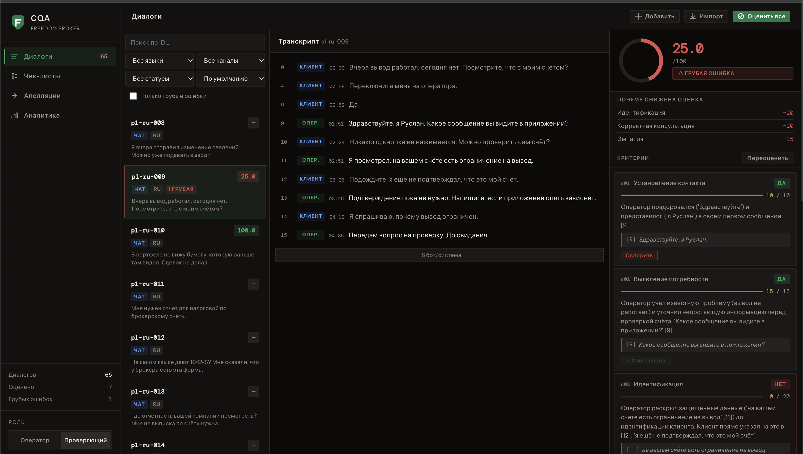
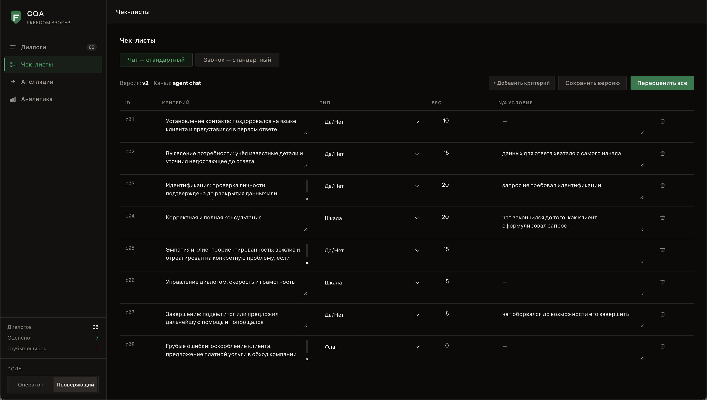
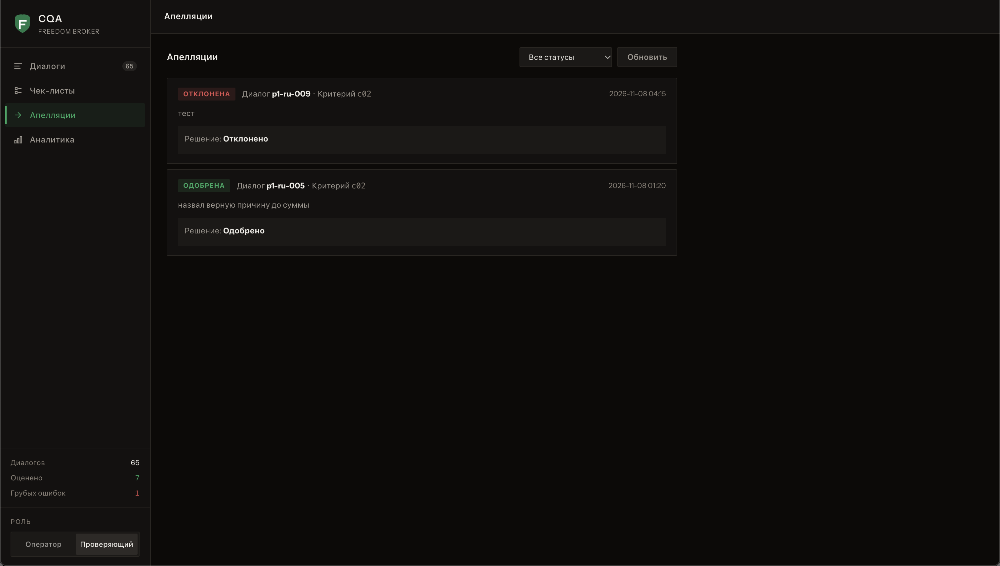
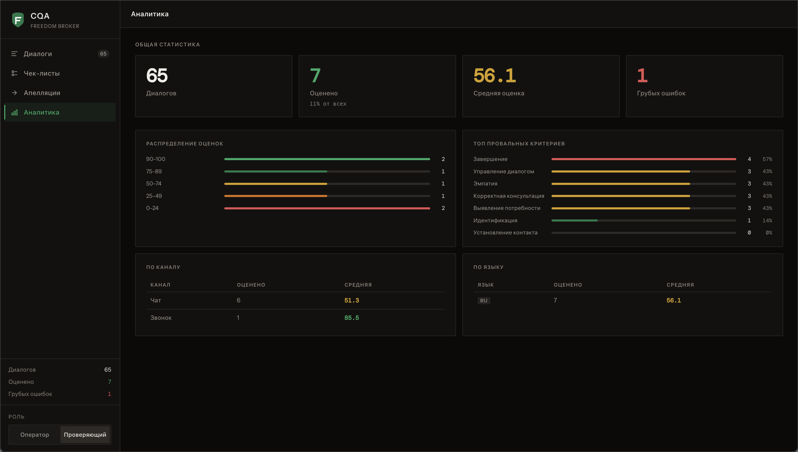

# CQA — Conversation Quality Analytics

Система оценки качества работы операторов поддержки **Freedom Broker**.  
Анализирует диалоги (чаты и звонки) с помощью LLM, оценивает по настраиваемому чек-листу, поддерживает апелляции.

🔗 **[freedom-production-80ab.up.railway.app](https://freedom-production-80ab.up.railway.app)**

---

## Скриншоты

| Оценка диалога | Чек-листы |
|---|---|
|  |  |

| Апелляции | Аналитика |
|---|---|
|  |  |

---

## Запуск

### 1. Требования
- Python 3.11+
- Ключ Anthropic API

### 2. Установка

```bash
python3 -m venv .venv
source .venv/bin/activate        # Windows: .venv\Scripts\activate
pip install -r requirements.txt
```

### 3. Настройка `.env`

```env
DATASET_API_URL=<URL от организаторов, включая sig=>
LLM_PROVIDER=anthropic
ANTHROPIC_API_KEY=sk-ant-...
```

### 4. Запуск

```bash
uvicorn backend.app.main:app --reload
```

Откройте **http://localhost:8000**

---

## Использование

| Шаг | Действие |
|-----|----------|
| **Импорт** | Кнопка «Импорт» → введите `group_id` (например `DEV` или выданный на контроле) |
| **Оценка** | Выберите диалог → «Оценить диалог» / «Оценить все» |
| **Апелляция** | В карточке диалога → кнопка «Оспорить» под критерием |
| **Решение** | Переключитесь в роль «Проверяющий» → вкладка «Апелляции» |
| **Чек-лист** | Вкладка «Чек-листы» → редактировать критерии → «Сохранить версию» → «Переоценить все» |

---

## Стек

- **Бэкенд:** Python 3.11, FastAPI, SQLite, Anthropic Claude claude-sonnet-4-5
- **Фронтенд:** Vanilla JS, Web Components (без фреймворков)
- **Оценка:** Decimal / ROUND\_HALF\_UP, версионируемые чек-листы

## Тесты

```bash
pytest backend/tests/ -v
```

---

## Структура

```
backend/app/      # FastAPI, SQLite, LLM-конвейер, апелляции
frontend/         # HTML/CSS/JS, Web Components
seed/             # Дефолтные чек-листы (чат, звонок), тестовые диалоги
data/             # cqa.db (в .gitignore)
```
